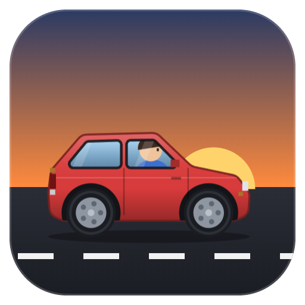
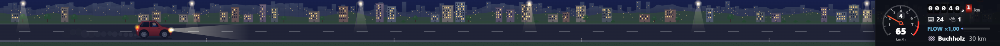

<h1 align="center">Taskbar Turbo</h1>

<b>Dein Arbeitstag ist ein Roadtrip.</b> 
Ein kleines Auto fährt über deine Taskleiste. Jede Taste und jeder Klick gibt Gas.

## Download

**[→ Neueste Version herunterladen](https://github.com/ninico219/TaskbarTurbo-Release/releases/latest)**
(`Taskbar-Turbo-Setup-….exe` unter *Assets*)

Für Windows 10 und 11 (64 Bit). Updates kommen danach automatisch: Die App lädt neue Versionen im
Hintergrund und installiert sie beim nächsten Beenden.

> **Windows-Warnung beim ersten Start:** Der Installer ist noch nicht digital signiert. Windows SmartScreen
> zeigt deshalb „Der Computer wurde durch Windows geschützt“. Auf **Weitere Informationen → Trotzdem ausführen**
> klicken. Das ist bei kleinen, neuen Programmen normal.

## Was passiert da?

- **Tippen = Gas.** Je schneller du arbeitest, desto schneller fährt das Auto, mit Gängen, Drehzahlmesser,
  Flow und Nitro.
- **Jede Taste macht etwas:** Leertaste hüpft, Backspace bremst, Strg+Z legt den Rückwärtsgang ein, Esc hupt.
- **Eine echte Reise:** Saison 1 führt von Hamburg nach Lissabon, 3.760 km durch 6 Länder, mit Ortsschildern,
  Grenzen und Stempeln im Reisepass.
- **Tankstellen mit Teilen:** Lacke, Felgen, Dachboxen, Beifahrer. Sammle sie und bau sie in der Garage an.
- **Blitzer:** Wer richtig schnell tippt, wird geblitzt. Das Foto landet in deiner Sammlung.
- **Stört nicht:** Klicks gehen durch die Straße hindurch. Bei Spielen, Videos und Präsentationen im Vollbild
  blendet sich das Auto aus, die Kilometer zählen trotzdem weiter.

## Bedienung

Das rote Auto unten rechts im Infobereich ist die Steuerzentrale: **Linksklick** öffnet die Garage,
**Rechtsklick** das Menü (Modus, Ton, Autostart, Beenden).

| Kürzel | Wirkung |
|---|---|
| `Strg+Alt+G` | Garage öffnen |
| `Strg+Alt+H` | Auto aus-/einblenden |
| `Strg+Alt+M` | Modus wechseln: Taskleiste → Widget → Panorama |

## Datenschutz

Taskbar Turbo **zeichnet nicht auf, was du tippst.** Jede Eingabe wird sofort in eine grobe Kategorie übersetzt
(Buchstabe, Leertaste, Klick …) und der Rest verworfen. Gespeichert werden nur Zähler und dein Spielstand, und zwar
lokal unter `%APPDATA%\Taskbar Turbo\`. Ins Internet geht die App nur, um nach Updates zu suchen.

## Probleme?

Fehler und Wünsche gern als [Issue](https://github.com/ninico219/TaskbarTurbo-Release/issues) melden.
